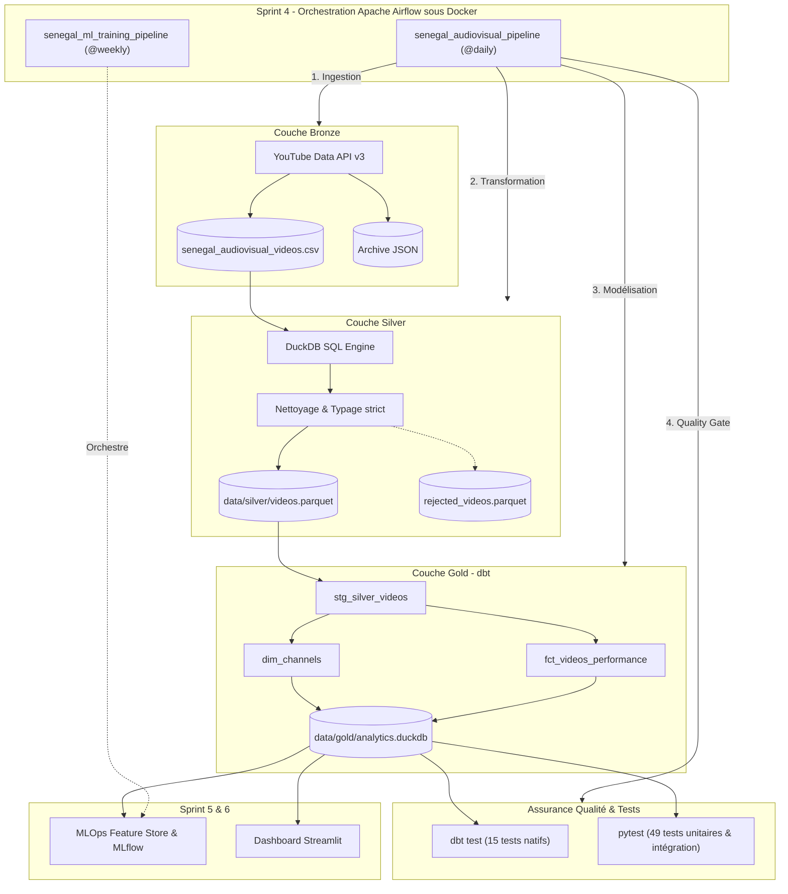

# Sénégal Audiovisual Intelligence Platform 🇸🇳 🎬

Plateforme d'ingénierie et d'intelligence des données audiovisuelles sénégalaises, conçue selon l'**Architecture Médaillon** et les meilleures pratiques du Data Engineering moderne.

---

## 1. Présentation et Vision

Le secteur audiovisuel sénégalais connaît une effervescence remarquable portée par des maisons de production phares telles que **Marodi TV**, **EvenProd** et **Pikini Production**.  
L'objectif de cette plateforme est de construire pas à pas un pipeline robuste, vérifiable et conforme pour acquérir, valider, nettoyer, modéliser, orchestrer et valoriser les métadonnées de ces catalogues via l'API officielle YouTube Data v3.

### Avancement du Projet par Sprints :
* **Sprint 1 (Couche Bronze) — Terminé & Validé :** Client HTTP YouTube v3 sécurisé, audit qualité mémoire, extraction et sauvegarde brute de 15 832 vidéos publiques ([data/raw/senegal_audiovisual_videos.csv](file:///c:/Users/7MAKSACOD%20PC/Desktop/Projet/Audiovisuel/data/raw/senegal_audiovisual_videos.csv)).
* **Sprint 2 (Couche Silver) — Terminé & Validé :** Moteur SQL analytique local sous **DuckDB**, typage fort, déduplication idempotente, isolation en quarantaine, sérialisation colonnaire en **Apache Parquet**, 38 tests unitaires/intégration et rapport technique PDF.
* **Sprint 3 (Couche Gold & dbt) — Terminé & Validé :** Modélisation dimensionnelle en étoile avec **dbt-duckdb**, création de `dim_channels` et `fct_videos_performance`, calculs des ratios d'engagement, classification des formats de contenu, 15 tests dbt, 43 tests pytest globaux et rapport technique PDF.
* **Sprint 4 (Orchestration Airflow & Docker) — Terminé & Validé :** Orchestration conteneurisée du pipeline Médaillon complet avec **Apache Airflow 2.10**, stack Docker (`docker-compose.yml`), DAG mince `senegal_audiovisual_pipeline`, Quality Gate déclaratif, DAG MLOps préparé et 49 tests pytest 100% passants.
* **Sprint 5 (MLOps & MLflow) — Prochain Sprint :** Feature Store (`src/ml/features.py`), modèles prédictifs d'audience (`src/ml/train.py`, `evaluate.py`) et tracking d'expériences via **MLflow**.
* **Sprint 6 (Restitution Streamlit) — Cible :** Tableau de bord interactif pour les producteurs et décideurs audiovisuels.

---

## 2. Architecture Médaillon et Flux des Données



---

## 3. Structure du Répertoire

```text
Audiovisuel/
│
├── .env.example                     # Modèle de configuration des secrets (API YouTube & Airflow)
├── .gitignore                       # Exclusions Git (données volumineuses, .env, caches)
├── requirements.txt                 # Dépendances Python (requests, duckdb, pyarrow, dbt-duckdb, reportlab, pytest)
├── Dockerfile                       # Image Docker personnalisée Airflow 2.10 avec toutes les dépendances
├── docker-compose.yml               # Stack de production Airflow (PostgreSQL, Webserver, Scheduler)
├── README.md                        # Documentation officielle de référence
│
├── docs/
│   └── youtube_api_compliance.md    # Analyse juridique, quotas et conformité YouTube
│
├── dags/                            # DAGs Airflow d'orchestration
│   ├── audiovisual_pipeline.py      # DAG principal Médaillon (Bronze -> Silver -> Gold -> Qualité)
│   └── ml_training_pipeline.py      # DAG MLOps d'entraînement périodique (Sprint 5)
│
├── src/
│   ├── __init__.py                  # Marqueur de package
│   ├── config.py                    # Chargement sécurisé et masquage des secrets
│   ├── youtube_client.py            # Client API v3, DTOs et gestion des erreurs/quotas (Bronze)
│   ├── audit.py                     # Contrôle qualité de premier niveau (Bronze)
│   ├── transformations/             # Logique de transformation Médaillon
│   │   ├── __init__.py
│   │   └── silver.py                # Pipeline Bronze -> Silver sous DuckDB
│   └── quality/                     # Assurance qualité et contrats de données
│       ├── __init__.py
│       └── silver_checks.py         # Audits de conformité, bornes et contraintes Parquet
│
├── dbt_project/                     # Projet dbt-duckdb (Couche Gold)
│   ├── dbt_project.yml              # Configuration du projet dbt
│   ├── profiles.yml                 # Profil dbt-duckdb pointant vers data/gold/analytics.duckdb
│   └── models/
│       ├── staging/
│       │   ├── sources.yml          # Déclaration de la source Silver externe Parquet
│       │   └── stg_silver_videos.sql# Vue de staging sur videos.parquet
│       └── gold/
│           ├── dim_channels.sql     # Dimension référentielle des 3 chaînes
│           ├── fct_videos_performance.sql # Table de faits centrale des vidéos
│           └── schema.yml           # 15 tests dbt (unicité, intégrité, valeurs acceptées)
│
├── scripts/
│   ├── run_audit.py                 # Pipeline d'audit volatile mémoire (Bronze)
│   ├── collect_dataset.py           # Collecte industrielle du catalogue YouTube (Bronze)
│   ├── transform_silver.py          # CLI de transformation et d'export Parquet (Silver)
│   ├── run_gold.py                  # Wrapper d'exécution et de validation Gold (dbt run & test)
│   ├── generate_pdf_report.py       # Générateur du rapport technique Sprint 2 en PDF
│   ├── generate_pdf_report_sprint3.py # Générateur du rapport technique Sprint 3 en PDF
│   └── generate_pdf_report_sprint4.py # Générateur du rapport technique officiel Sprint 4 en PDF
│
├── tests/
│   ├── __init__.py
│   ├── test_config.py               # Tests unitaires de configuration (8 tests)
│   ├── test_youtube_client.py       # Tests unitaires du client API mocké (15 tests)
│   ├── test_audit.py                # Tests unitaires d'audit mémoire (8 tests)
│   ├── test_silver.py               # Tests unitaires et d'intégration Silver (7 tests)
│   ├── test_gold.py                 # Tests unitaires et d'intégration Gold (5 tests)
│   └── test_dags.py                 # Tests unitaires d'intégrité Airflow & Docker (6 tests)
│
├── data/
│   ├── raw/                         # Couche Bronze : données brutes immuables
│   │   ├── senegal_audiovisual_videos.csv (15 832 vidéos - 3.00 Mo)
│   │   └── senegal_audiovisual_videos.json (Archive complète - 8.19 Mo)
│   ├── silver/                      # Couche Silver : tables Parquet nettoyées
│   │   └── videos.parquet           (15 832 vidéos typées - 1.05 Mo)
│   ├── gold/                        # Couche Gold : entrepôt DuckDB analytique
│   │   └── analytics.duckdb         (Base OLAP dbt contenant dimensions et faits)
│   └── quarantine/                  # Isolation des enregistrements corrompus
│       └── .gitkeep
│
├── reports/                         # Rapports techniques officiels en PDF
│   ├── RAPPORT_TECHNIQUE_SPRINT_2.pdf # Rapport d'avancement Sprint 2 (Silver)
│   ├── RAPPORT_TECHNIQUE_SPRINT_3.pdf # Rapport d'avancement Sprint 3 (Gold & dbt)
│   ├── RAPPORT_TECHNIQUE_SPRINT_4.pdf # Rapport d'avancement Sprint 4 (Airflow & Docker)
│   └── silver_execution_report_*.json # Rapports JSON d'exécution horodatés
│
└── logs/                            # Journaux d'exécution horodatés
    ├── gold_pipeline.log            # Logs détaillés de la couche Gold
    └── data_collection.log          # Logs de collecte Bronze
```

---

## 4. Orchestration Airflow & Déploiement Docker (Sprint 4)

### A. Le DAG Maître : `senegal_audiovisual_pipeline`
Le DAG orchestre séquentiellement chaque étape du pipeline avec des mécanismes stricts de tolérance aux pannes :
1. `start_pipeline` : Marqueur de début de cycle.
2. `task_bronze_ingestion` : Ingestion sécurisée YouTube (`scripts/collect_dataset.py --check-existing`).
3. `task_silver_transformation` : Typage et écriture Parquet sous DuckDB (`scripts/transform_silver.py`).
4. `task_gold_modeling` : Matérialisation des dimensions et faits sous dbt (`scripts/run_gold.py --only-run`).
5. `task_data_quality_gate` : Exécution des 15 tests dbt d'intégrité (`scripts/run_gold.py --only-test`).
6. `task_pipeline_summary` : Génération du rapport technique officiel PDF (`scripts/generate_pdf_report_sprint4.py`).
7. `end_pipeline` : Validation finale et succès du run.

**Paramètres de résilience appliqués :**
* `retries: 2` et `retry_delay: 3 minutes` pour absorber les instabilités réseau.
* `catchup: False` pour éviter les exécutions rétroactives massives.
* `max_active_runs: 1` pour empêcher les conflits concurrents sur la base DuckDB.

### B. Déploiement Conteneurisé avec Docker Compose
Pour démarrer l'ensemble des services Airflow (PostgreSQL, Webserver, Scheduler) :

```powershell
# 1. Démarrer Docker Desktop sur Windows
# 2. Lancer la stack multi-conteneurs en tâche de fond :
docker compose up -d

# 3. Vérifier l'état de santé des conteneurs :
docker compose ps
```

* **Interface Web Airflow :** [http://localhost:8080](http://localhost:8080)
* **Identifiants par défaut :**
  - Nom d'utilisateur : `admin`
  - Mot de passe : `admin`

Pour arrêter la stack :
```powershell
docker compose down
```

---

## 5. Guide d'Exécution Local & Tests (PowerShell)

### A. Activation de l'environnement virtuel
```powershell
.\.venv\Scripts\Activate.ps1
```

### B. Lancement de la suite complète de tests (62 tests automatisés)
```powershell
.\.venv\Scripts\python.exe -m pytest -v
```

### C. Exécution unitaire des composants du pipeline
```powershell
# Couche Bronze (contrôle d'idempotence) :
.\.venv\Scripts\python.exe scripts/collect_dataset.py --check-existing

# Couche Silver (DuckDB + Parquet) :
.\.venv\Scripts\python.exe scripts/transform_silver.py

# Couche Gold (dbt run & test via le wrapper) :
.\.venv\Scripts\python.exe scripts/run_gold.py

# Cycle MLOps (Sprint 5) :
.\.venv\Scripts\python.exe -m src.ml.features
.\.venv\Scripts\python.exe -m src.ml.train
.\.venv\Scripts\python.exe -m src.ml.evaluate
.\.venv\Scripts\python.exe -m src.ml.predict --channel EvenProd --type EPISODE --duration 32 --hour 20 --day Friday

# Application Web Décisionnelle & Simulateur d'Audience (Sprint 6) :
.\.venv\Scripts\streamlit.exe run app/main.py

# Génération des Rapports Techniques officiels en PDF :
.\.venv\Scripts\python.exe scripts/generate_pdf_report_sprint4.py
.\.venv\Scripts\python.exe scripts/generate_pdf_report_sprint5.py
.\.venv\Scripts\python.exe scripts/generate_pdf_report_sprint6.py
```

---

## 6. Métriques de Performance et Benchmarks MLOps

| Composant | Couche Bronze | Couche Silver | Couche Gold (dbt) | Orchestration Airflow | MLOps (Sprint 5) | App Décisionnelle (Sprint 6) |
|---|---|---|---|---|---|---|
| **Format / Outil** | CSV UTF-8 | Apache Parquet (Snappy) | DuckDB OLAP Table | DAGs Python Docker | Scikit-Learn + MLflow | Streamlit + Plotly |
| **Volume de vidéos** | 15 832 | 15 832 | 15 832 | 15 832 ordonnancées | 12 665 Train / 3 167 Test | 15 832 en direct |
| **Taille / Modèles** | 3.00 Mo | 1.05 Mo (2.85x plus compact) | ~ 4.8 Mo (indexé) | Métastore PostgreSQL | RF Regressor + HistGB Clf | **6 Tableaux de bord interactifs** |
| **Performances Clés** | Dépend API | 0.412 seconde | 1.46 s (run) / 1.41 s (test) | Workflow < 5s | **R² = 0.8006 \| ROC-AUC = 0.9871** | Inférence < 25 ms |
| **Tests automatisés** | 31 tests pytest | 7 tests pytest | 15 tests dbt + 5 pytest | 6 tests DAGs & Docker | 8 tests pytest MLOps | **5 tests pytest & AppTest** |
| **TOTAL TESTS SUITE** | **62 tests passants à 100% sur l'ensemble de la plateforme (Pytest 9.1)** | | | | | |

---

## 7. Rapports Techniques Officiels en PDF

Tous les rapports de validation d'ingénierie sont compilés au format PDF dans [reports/](file:///c:/Users/7MAKSACOD%20PC/Desktop/Projet/Audiovisuel/reports/) :
* [reports/RAPPORT_TECHNIQUE_SPRINT_2.pdf](file:///c:/Users/7MAKSACOD%20PC/Desktop/Projet/Audiovisuel/reports/RAPPORT_TECHNIQUE_SPRINT_2.pdf) : Validation de la Couche Silver Parquet.
* [reports/RAPPORT_TECHNIQUE_SPRINT_3.pdf](file:///c:/Users/7MAKSACOD%20PC/Desktop/Projet/Audiovisuel/reports/RAPPORT_TECHNIQUE_SPRINT_3.pdf) : Modélisation Gold Star Schema & dbt-duckdb.
* [reports/RAPPORT_TECHNIQUE_SPRINT_4.pdf](file:///c:/Users/7MAKSACOD%20PC/Desktop/Projet/Audiovisuel/reports/RAPPORT_TECHNIQUE_SPRINT_4.pdf) : Orchestration Airflow, DAGs & Conteneurisation Docker.
* [reports/RAPPORT_TECHNIQUE_SPRINT_5.pdf](file:///c:/Users/7MAKSACOD%20PC/Desktop/Projet/Audiovisuel/reports/RAPPORT_TECHNIQUE_SPRINT_5.pdf) : Industrialisation MLOps, Tracking MLflow & Inférence Hybride.
* [reports/RAPPORT_TECHNIQUE_SPRINT_6.pdf](file:///c:/Users/7MAKSACOD%20PC/Desktop/Projet/Audiovisuel/reports/RAPPORT_TECHNIQUE_SPRINT_6.pdf) : Plateforme Décisionnelle Interactive, Simulateur d'Audience, Étude Comportementale & MLOps.

---

## 8. Synthèse Finale du Sprint 6 (Application & Dashboard Décisionnel)

Le **Sprint 6** finalise l'industrialisation de la plateforme avec une interface utilisateur de pointe pour les professionnels de l'audiovisuel :
1. **Observatoire du Marché & Benchmark Concurrentiel :** Grille de 8 KPIs certifiés (Vues, Médiane, P90, Engagement, Indice de débat, Pénétration HD) et tableau comparatif des 3 leaders.
2. **Analyse Comportementale du Public Sénégalais :** Matrice de chaleur 2D (Jour x Heure), corrélation vues vs fidélité communautaire, analyse de controverse (Likes vs Commentaires) et dispersion par format (Box Plots).
3. **Observatoire des Franchises & Séries Cultes :** Classement des 17 sagas majeures (Karma, Bété Bété, Virginie, Infidèles, etc.) et impact des franchises sur l'audience.
4. **Simulateur d'Audience, Hit Predictor & Test A/B en Direct :** Estimation centrale, intervalle à 80%, jauge de probabilité virale et module comparatif de deux stratégies de diffusion.
5. **Recommandations Stratégiques & Optimiseur Éditorial :** Bonnes pratiques empiriques sur le Prime-Time (19h30 - 21h30 GMT), durées idéales et effet de teasing.
6. **Espace MLOps & Rigueur Scientifique :** Visualisation interactive des métriques d'évaluation, matrices de confusion et courbes ROC certifiées.
7. **Analyse des Sentiments du Public & Commentaires (NLP Bilingue) :** Moteur d'analyse hybride français/wolof évaluant la satisfaction nette (NSS), la cartographie des controverses, la détection des termes d'éloge vs critiques et un testeur interactif en direct.

**Assurance Qualité Globale :** 63 tests automatisés passants à 100% (`pytest tests/ -v`).
